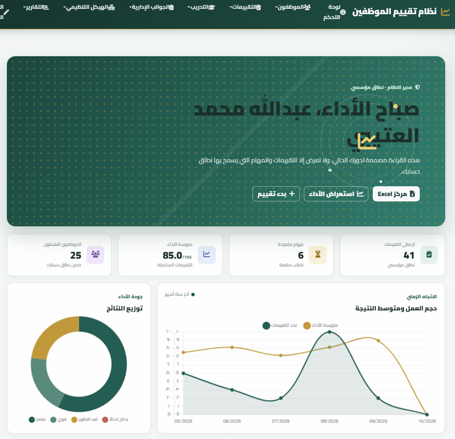
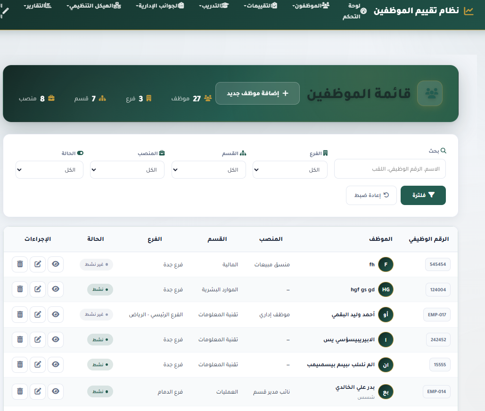
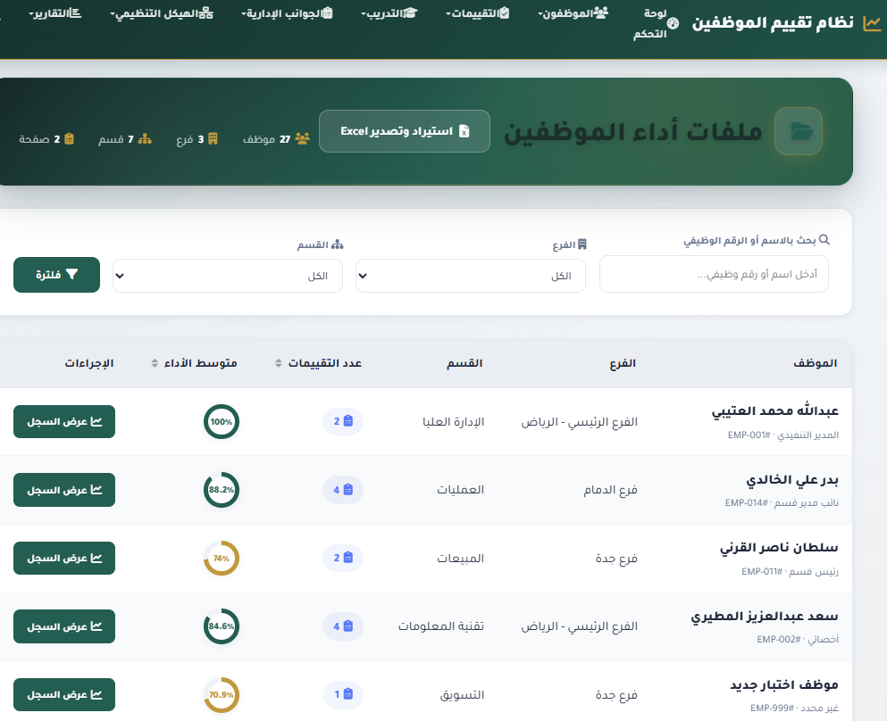
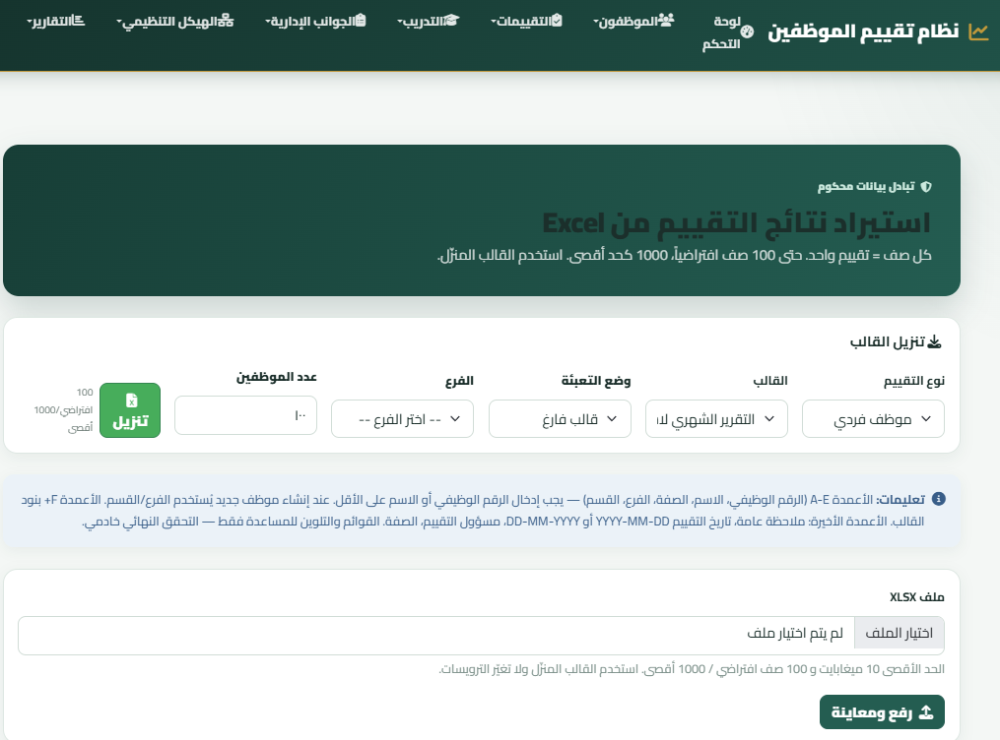
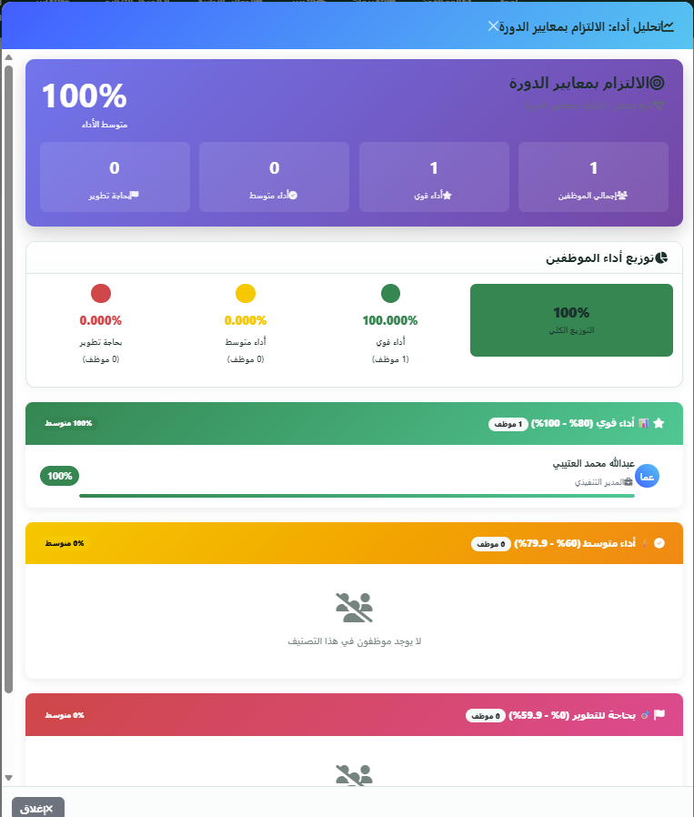
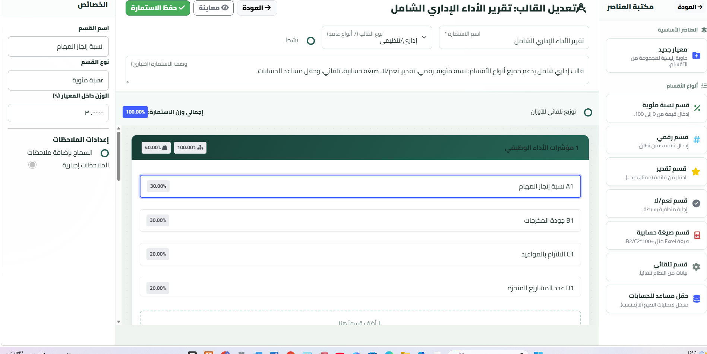

<div dir="rtl">

# نظام تقييم أداء الموظفين

[](LICENSE)


نظام متكامل لتقييم أداء الموظفين والوحدات التنظيمية، مبني بمعمارية **MVC مخصصة** بلغة PHP، يوفر محرك تقييم مرنًا (موظفون · فروع · أقسام · دورات · ورش عمل)، ونظام صلاحيات دقيقًا (RBAC)، وتقارير PDF/Excel، وسجل تدقيق كامل.

---

## ✨ المميزات الرئيسية

- **محرك تقييم مرن**: قوالب نماذج بتوجيهات دقيقة (موظف، موظف في دورة/ورشة، دورة، ورشة، وحدة تنظيمية) مع جدولة دورية (يومي/أسبوعي/شهري/ربع سنوي/سنوي/مخصص).
- **منشئ نماذج مرئي (Form Builder)**: بناء الاستمارات ومؤشرات الأداء وأقسامها ومعاييرها عبر واجهة سحب وإفلات مع معاينة فورية.
- **لوحات تحكم ذكية حسب الدور**: كل شخصية مستخدم (مدير نظام، موارد بشرية، مدير فريق، مقيّم) ترى مؤشرات ونطاق بيانات مختلفين يُحدّده الخادم — لا اعتماد على تصفية المتصفح.
- **إدارة هيكل المؤسسة**: الفروع، الأقسام، الوظائف، الموظفون، وربط الموظفين بمديريهم ومقيّميهم.
- **استيراد/تصدير Excel**: قوالب استيراد ذكية للمقيمين والمدربين مع معاينة قبل الاعتماد، وتصدير التقييمات والتقارير.
- **تقارير وتقارير PDF**: تقارير فردية وجماعية ومؤسسية مع طباعة مهيأة ورسوم بيانية تفاعلية (Chart.js).
- **تدريب وتطوير**: إدارة الدورات التدريبية والورش وكتالوج التدريب وتقييمات المتدربين.
- **نسخ احتياطي مؤسسي**: جدولة وتنفيذ نسخ احتياطية مع تشفير ومراقبة.
- **إشعارات وتدقيق**: نظام إشعارات داخلي وسجل تدقيق (Audit Log) لكل عملية حساسة، مثل تحديث الأدوار وتغيير كلمات المرور.

---

## 📸 لقطات من النظام

| رقم ١ | رقم ٢ | رقم ٣ |
|:---:|:---:|:---:|
|  |  |  |

| رقم ٤ | رقم ٥ | رقم ٦ |
|:---:|:---:|:---:|
|  |  |  |

| رقم ٧ |
|:---:|
|  |

---

## 👥 الأدوار والصلاحيات (RBAC)

يتحكم الخادم في بيانات كل لوحة تحكم قبل عرضها، وفق مصفوفة صلاحيات مخزّنة في قاعدة البيانات:

| شخصية اللوحة | نطاق البيانات | المكونات الأساسية |
|---|---|---|
| **مدير النظام / الموارد البشرية** | المؤسسة كاملة | حجم التقييمات، الإنجاز، متوسط النتيجة، الاتجاه الشهري، توزيع النتائج، اختصارات الإدارة |
| **مدير الفريق** | الموظفون المرتبطون بـ `manager_id` | ملخص الفريق، المهام المفتوحة، أداء الفريق واتجاهه |
| **المقيّم** | التقييمات المسندة إليه | المسودات، المكتمل، متوسط النتائج، اختصار مركز Excel |
| **المستخدم المحدود** | التقييمات التي هو فيها الموظف المقيَّم | ملخص شخصي ونشاطه فقط |

الأدوار قابلة للتخصيص الكامل من شاشة **إدارة الأدوار والصلاحيات** (صلاحيات دقيقة على مستوى الإجراء: `view` / `create` / `update` / `delete` / `manage`).

---

## ⚙️ المحرك التقييم ومؤشرات الأداء

- **قوالب نماذج متعددة الأهداف**: كل قالب يُوجَّه لكيان محدد (موظف/دورة/ورشة/وحدة) مع نطاق فرع أو قسم.
- **جدولة التقييمات**: إنشاء دورات تقييم دورية تلقائية للوحدات التنظيمية.
- **تطبيع الدرجات**: كل إجابة تُطبَّع إلى درجة معيارية (`normalized_score`) لضمان قابلية المقارنة بين المعايير المختلفة الأوزان.
- **التقييمات المرنة**: تقييمات للمتدربين داخل الدورات والورش بجانب تقييم الموظفين الروتيني.
- **مؤشرات مؤسسية**: متوسطات، اتجاهات زمنية، توزيع نتائج، ونسب إنجاز تُحتسب خادميًا.

---

## 🛠️ البنية التقنية

| المكوّن | التقنية |
|---|---|
| اللغة | PHP 8.2 (مع `strict types` في الوحدات الحديثة) |
| المعمارية | MVC مخصصة: Router · Controller · Model · View · Middleware |
| قاعدة البيانات | MySQL / MariaDB (utf8mb4) — PDO Prepared Statements |
| توليد PDF | dompdf · TCPDF · mPDF |
| Excel | PhpSpreadsheet (استيراد/تصدير/قوالب ديناميكية) |
| الرسوم البيانية | Chart.js + chartjs-plugin-datalabels |
| الحزم | Composer (PSR-4 autoload لمجلد `app/`) |
| الاختبارات | PHPUnit + مجموعة اختبارات تشغيل مخصصة داخل `tests/` |

---

## 🚀 المتطلبات وخطوات التشغيل

1. **المتطلبات**: [XAMPP](https://www.apachefriends.org/) (Apache + MySQL + PHP 8.2+) أو ما يعادلها.
2. **الاستنساخ** إلى مجلد الويب:
   ```
   C:\xampp\htdocs\employee-evaluation
   ```
3. **قاعدة البيانات**: أنشئ قاعدة بيانات باسم `employee_evaluation_mvc` بترميز `utf8mb4` واستورد ملف SQL المرفق.
4. **ملف الإعدادات**: أنشئ `config/database.php` (غير مضمّن في المستودع حمايةً للبيانات):
   ```php
   define('DB_HOST', 'localhost');
   define('DB_USER', 'root');
   define('DB_PASS', '');
   define('DB_NAME', 'employee_evaluation_mvc');
   define('DB_CHARSET', 'utf8mb4');
   ```
5. **تثبيت الحزم**:
   ```
   composer install
   ```
6. **التشغيل**: افتح
   ```
   http://localhost/employee-evaluation/login
   ```

---

## 📁 هيكل المشروع

```
employee-evaluation/
├── app/                  # نواة التطبيق (MVC)
│   ├── Controllers/      # المتحكمات
│   ├── Models/           # النماذج (PDO)
│   ├── Views/            # القوالب (PHP)
│   ├── Core/             # Router · Database · Auth · CSRF · helpers
│   └── Libraries/        # محركات PDF/Excel والمساعدات
├── config/               # الإعدادات (database.php خارج المستودع)
├── database/migrations/  # ترحيلات SQL موثّقة
├── docs/                 # التوثيق التقني والتقارير
├── public/               # نقطة الدخول + الأصول العامة
├── routes/               # تعريف المسارات (web.php)
├── storage/              # السجلات والنسخ الاحتياطية
├── tests/                # الاختبارات (PHPUnit + Smoke Tests)
├── LICENSE
└── README.md
```

---

## ✅ الاختبارات

```
C:\xampp\php\php.exe tests\runner.php
```

تشمل اختبارات دخان (Smoke Tests) للوحات التحكم حسب الدور وسير عمل Excel، بالإضافة إلى تقارير اختبارات مرحلية كاملة داخل `docs/`.

---

## 🔒 الأمان

- حماية **CSRF** لكل نماذج POST مع رموز تحدّث دوريًا.
- جلسات آمنة: `HttpOnly` · `SameSite=Strict` · معرّفات صارمة · اسم جلسة مخصّص.
- تحقق صارم من الصلاحيات على مستوى الخادم لكل مسار وميثود.
- كلمات المرور مخزّنة بـ **bcrypt/Argon2** مع سياسة إجبارية للتغيير.
- Prepared Statements في كل استعلامات قاعدة البيانات (ضد حقن SQL).
- تسجيل تدقيق (Audit Log) للعمليات الحساسة.

---

## 📄 الترخيص

هذا المشروع مرخص بموجب رخصة **MIT** — راجع ملف [LICENSE](LICENSE) للتفاصيل.

</div>
